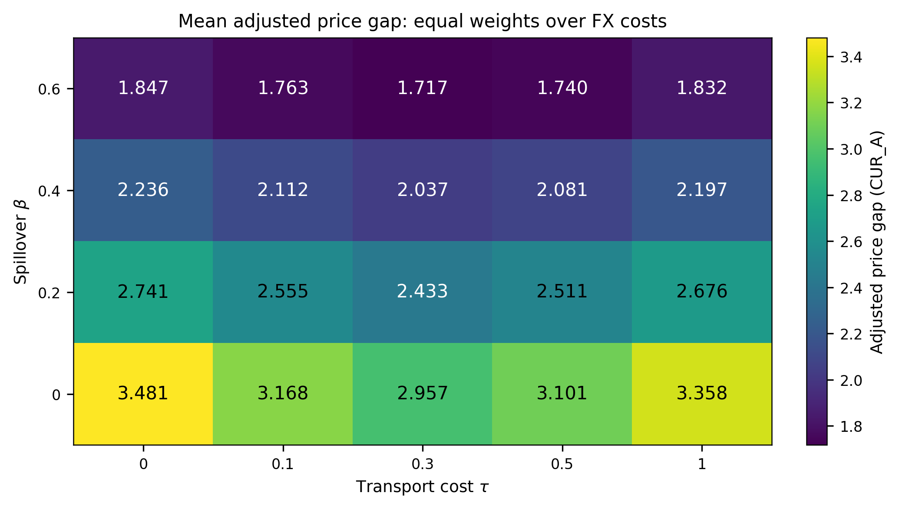
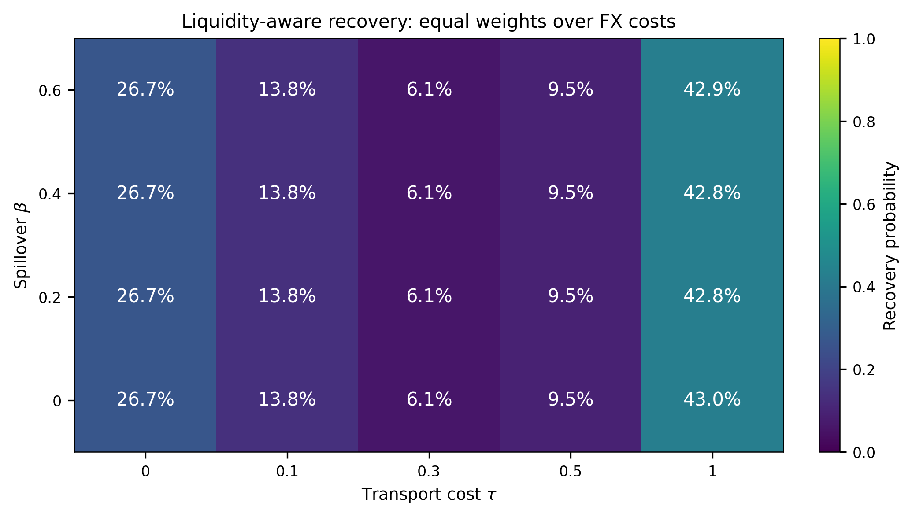
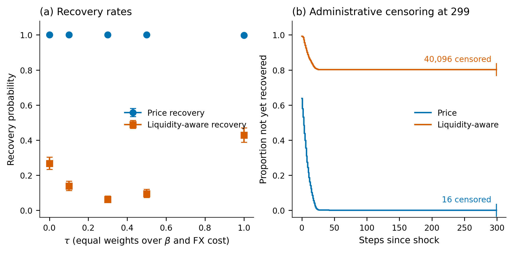
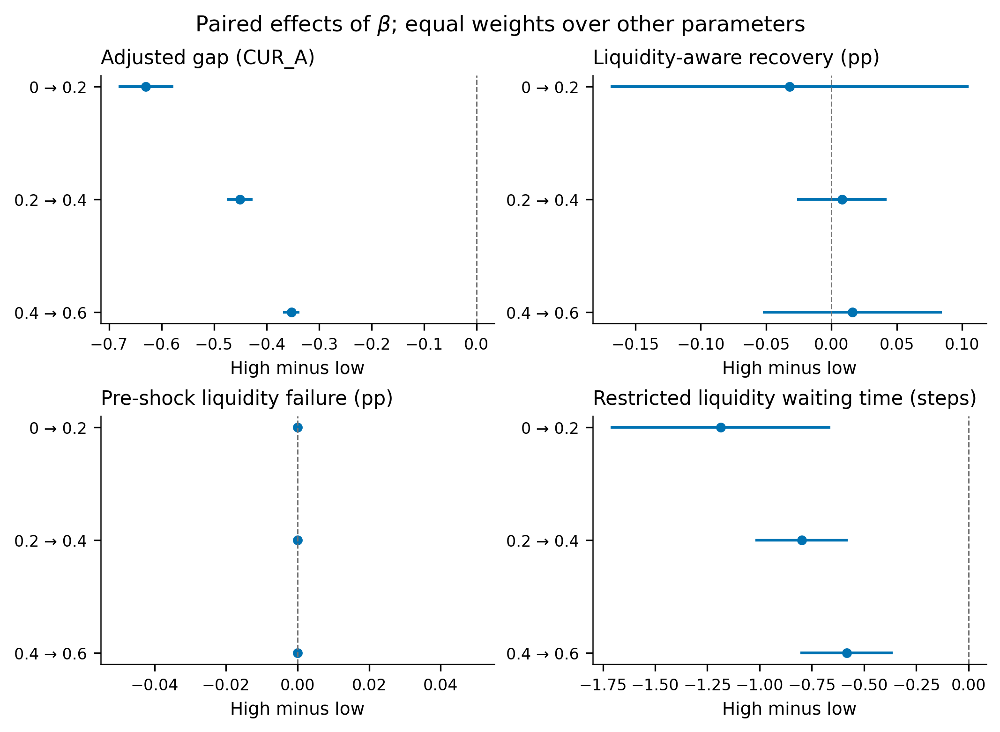
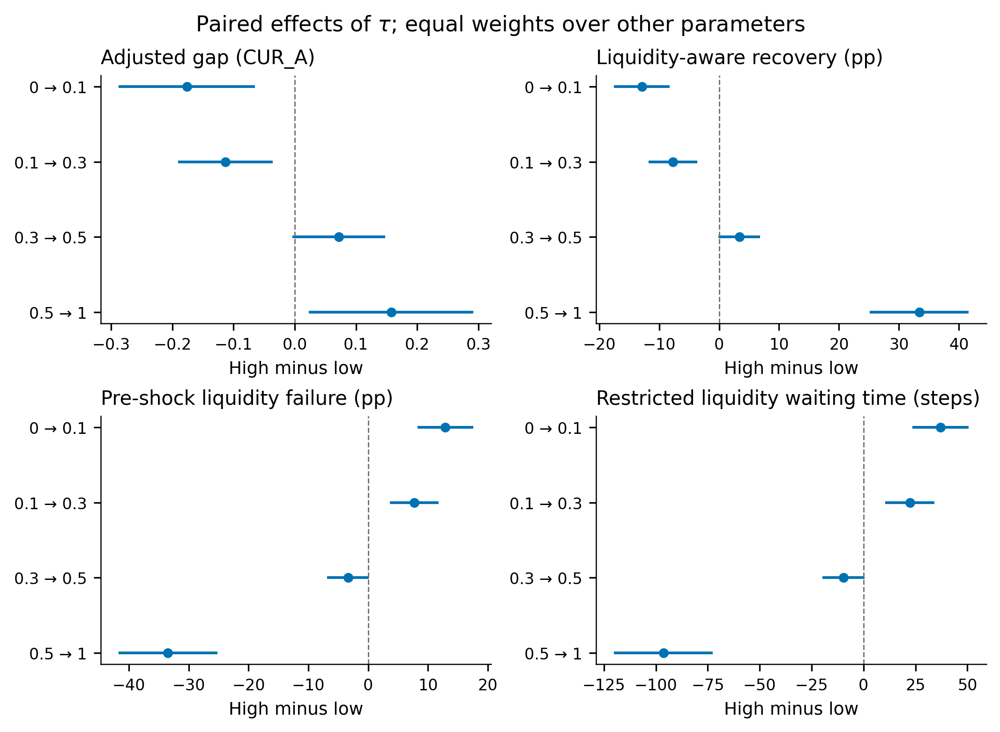
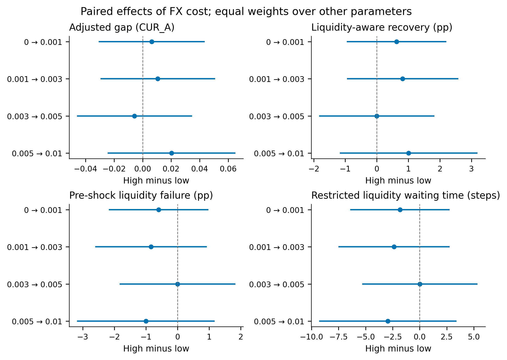

<div align="center">

# From Micro-Manipulation to Systemic Risk

### A 2D Agent-Based Model of a Dual-Market Financial System

**Computational Finance · Agent-Based Modeling · Market Microstructure · Systemic Risk**


**How can local market disturbances propagate through interconnected financial markets?**

A spatial agent-based simulation framework for studying market interactions,
cross-market transmission, price dynamics, liquidity, and recovery.

[Research Overview](#-research-overview) ·
[Experimental Design](#-experimental-design) ·
[Key Findings](#-key-findings) ·
[Visualizations](#-visualizations) ·
[Reproducibility](#-reproducibility)

---

**Research manuscript in preparation**

</div>

## Research Overview

Financial markets are complex systems in which interactions between individual
participants can produce aggregate behavior that is difficult to predict from
individual decisions alone.

This project develops a **two-dimensional agent-based model (ABM)** of an
interconnected financial system consisting of two asset markets and a foreign
exchange mechanism.

The framework is designed to investigate how market structure, transaction
costs, and cross-market interactions influence price discrepancies, liquidity,
and recovery following a localized disturbance.

Rather than assuming that markets continuously clear or immediately return
to equilibrium, the model explicitly represents trading interactions and
allows market-level outcomes to emerge from agent behavior.

### Research questions

The study investigates three central questions:

1. How do transaction costs influence price discrepancies between markets?
2. How does cross-market coupling affect the transmission of disturbances?
3. Can price-based recovery occur without simultaneous restoration of
   two-sided market liquidity?

A central motivation is that **price stabilization and functional market
recovery are not necessarily equivalent**.

---

## Model Architecture

The simulated financial system contains two interacting asset markets,
denoted **Market A** and **Market B**, connected through a foreign exchange
mechanism.

Agents operate in a two-dimensional environment and interact through
the model's trading and market mechanisms.

### Core components

| Component | Description |
|:---|:---|
| **Market A** | Asset market receiving the designated disturbance |
| **Market B** | Interconnected asset market used to study transmission |
| **FX mechanism** | Currency conversion between market environments |
| **Spatial agents** | Participants operating in a two-dimensional environment |
| **Order processing** | Trading interactions and market price formation |
| **Liquidity monitoring** | Availability of two-sided trading opportunities |
| **Recovery analysis** | Price-based and liquidity-aware recovery measurements |

### Main experimental parameters

| Parameter | Symbol | Interpretation |
|:---|:---:|:---|
| Transaction cost | `τ` | Cost associated with cross-market activity |
| Spillover strength | `β` | Intensity of cross-market coupling |
| FX transaction cost | `c_FX` | Cost associated with currency conversion |

The model introduces a designated disturbance in Market A at simulation
step **200**.

Subsequent observations are used to study the evolution of both markets
and the behavior of the recovery indicators.

---

## Experimental Design

The final experiment consists of a systematic parameter sweep.

<div align="center">

| Experimental characteristic | Value |
|:---|---:|
| Parameter configurations | **100** |
| Independent random seeds per configuration | **500** |
| Total simulation runs | **50,000** |
| Simulation steps per run | **500** |
| Disturbance step | **200** |
| Markets | **2 + FX mechanism** |

</div>

### Parameter grid

| Parameter | Values |
|:---|:---|
| `τ` | `0.0`, `0.1`, `0.3`, `0.5`, `1.0` |
| `β` | `0.0`, `0.2`, `0.4`, `0.6` |
| `c_FX` | `0.0`, `0.001`, `0.003`, `0.005`, `0.01` |

The full factorial design contains:

**5 × 4 × 5 = 100 parameter configurations**

Each configuration is evaluated using 500 random seeds.

The final experiment therefore contains:

**100 × 500 = 50,000 simulation runs**

### Why repeated simulations?

Agent-based models contain stochastic components.

A single trajectory may reflect random variation rather than a robust
property of the modeled system.

Repeated runs allow us to examine the distribution of outcomes and
quantify uncertainty.

The analysis also considers paired parameter comparisons and
multiple-comparison adjustments.

---

## Key Findings

The following findings describe the behavior of the simulated system
under the investigated experimental design.

They should not be interpreted as empirical estimates for real-world
financial markets.

### 1. Price recovery does not imply liquidity recovery

The study distinguishes two recovery definitions:

**Price-based recovery**

A recovery event occurs when the adjusted intermarket price gap returns
below its designated pre-disturbance reference threshold.

**Liquidity-aware recovery**

A recovery event additionally requires both asset markets to exhibit
two-sided liquidity at the same observation time.

These definitions lead to substantially different outcomes.

| Recovery metric | Observed share |
|:---|---:|
| Price-based recovery | **99.968%** |
| Liquidity-aware recovery | **19.808%** |

This difference is one of the central findings of the study.

> A system can satisfy a price-based stabilization criterion while
> failing a stricter criterion requiring simultaneous two-sided
> liquidity in both markets.

Importantly, the liquidity result should not automatically be attributed
to the disturbance: limited liquidity is also observed before the
designated shock.

### 2. Cross-market coupling influences price discrepancies

The parameter experiments indicate that stronger cross-market coupling
is associated with smaller adjusted price discrepancies under the
investigated model configurations.

However, this relationship is model-dependent and should not be
generalized to all financial systems.

### 3. Transaction-cost effects are not uniformly monotonic

Changes in transaction costs do not produce a universally monotonic
response across the investigated outcomes.

This highlights the importance of studying interactions between
model parameters rather than relying exclusively on one-factor
interpretations.

### 4. FX transaction-cost effects remain uncertain

The estimated FX-cost contrasts do not provide a clearly resolved
effect under the simultaneous confidence-interval procedure used
in the final analysis.

Accordingly, the study does not claim a robust directional FX-cost
effect.

---

## Visualizations

The following figures summarize the final experimental analysis.

### Adjusted intermarket price gap

<div align="center">



*Adjusted price-gap outcomes across experimental configurations.*

</div>

### Liquidity-aware recovery

<div align="center">



*Liquidity-aware recovery outcomes across parameter configurations.*

</div>

### Recovery and censoring

<div align="center">



*Comparison of recovery definitions and censored observations.*

</div>

### Parameter effects

**Cross-market coupling**



**Transaction costs**



**FX transaction costs**



The parameter-effect analysis accounts for repeated simulation seeds
and multiple comparisons.

---

## Stylized Facts

An additional experiment examines whether the model can reproduce
selected statistical characteristics commonly studied in financial
return series.

This analysis uses a **separate single-market baseline**, rather than
the full dual-market parameter sweep.

### Baseline experiment

| Characteristic | Value |
|:---|---:|
| Independent runs | **50** |
| Steps per run | **10,000** |
| Burn-in period | **100 steps** |

### Observed characteristics

**Heavy-tailed returns**

The simulated return distribution exhibits substantial excess kurtosis.

Median excess kurtosis across the baseline runs:

**53.548**

The observed frequency of returns exceeding three standard deviations
is approximately **1.919%**, compared with approximately **0.27%**
under a normal-distribution benchmark.

**Volatility clustering**

The baseline also exhibits positive serial dependence in absolute
and squared returns.

| Statistic | Lag-1 autocorrelation |
|:---|---:|
| Returns | **−0.140** |
| Absolute returns | **+0.324** |
| Squared returns | **+0.242** |

These results provide descriptive evidence of heavy tails and
volatility persistence in the simulated baseline.

They do **not** establish comprehensive empirical calibration.

The analysis also identifies limitations related to zero returns,
quote availability, and the model's price-formation mechanisms.

---

## Recovery Measurement

Recovery is evaluated after the designated disturbance.

The analysis uses an adjusted intermarket price gap, with a reference
threshold derived from the pre-disturbance period.

Two complementary indicators are considered:

| Indicator | Required condition |
|:---|:---|
| Price recovery | Adjusted price gap meets the reference threshold |
| Liquidity-aware recovery | Price condition and two-sided liquidity in both markets |

### Censoring

Some simulated trajectories do not satisfy the recovery condition
within the observation window.

These trajectories are treated as **right-censored observations**.

A censored trajectory is not interpreted as an observed recovery
at the end of the simulation.

This distinction is important when comparing recovery frequencies
and restricted waiting times.

---

## Repository Structure

```text
axaxax/
│
├── AgentBasedModel/
│   ├── agents/                 # Agent and market behavior
│   ├── simulator/              # Simulation engines
│   └── utils/                  # Orders, spatial and liquidity utilities
│
├── configs/                    # Experiment configurations
├── docs/                       # Research protocols and documentation
├── tests/                      # Validation and testing code
│
├── figures/                    # Earlier project figures
├── paper_figures_v2/           # Final research figures
├── tables/                     # Selected results and local outputs
│
├── main.py                     # Original simulation entry point
├── main_2d.py                  # 2D simulation entry point
├── experiments.py              # Experiment routines
├── experiment_runner.py        # Experiment execution utilities
├── final_experiment.py         # Final experiment workflow
├── final_parameter_effects.py  # Parameter-effect analysis
├── stylized_facts.py           # Stylized-facts analysis
├── make_paper_figures_v2.py    # Research figure generation
├── plot_results.py             # Visualization utilities
├── rob_check.py                # Robustness checks
│
├── requirements.txt            # Python dependencies
└── README.md                   # Project documentation
```

Additional validation and diagnostic scripts are included in the
repository.

---

## Installation

### 1. Clone the repository

```bash
git clone https://github.com/escyd/axaxax.git
cd axaxax
```

### 2. Create a virtual environment

```bash
python3 -m venv .venv
```

Activate it on macOS or Linux:

```bash
source .venv/bin/activate
```

On Windows:

```powershell
.venv\Scripts\Activate.ps1
```

### 3. Install dependencies

```bash
python -m pip install --upgrade pip
python -m pip install -r requirements.txt
```

---

## Reproducibility

The repository contains the simulation framework, experiment scripts,
configuration files, validation utilities, and figure-generation code.

The final parameter configuration is documented in:

```text
configs/final_experiment_v2.json
```

Additional methodological details are available in:

```text
docs/final_experiment_protocol.md
docs/stylized_facts_protocol.md
docs/stylized_facts_results.md
```

### Experimental workflow

The research workflow consists of:

1. Configure the model and experimental parameter grid.
2. Execute simulations using the designated random seeds.
3. Collect price, liquidity, and recovery measurements.
4. Aggregate results across independent runs.
5. Estimate parameter effects and uncertainty.
6. Generate publication figures and summary tables.

The relevant scripts include:

```text
final_experiment.py
experiment_runner.py
final_parameter_effects.py
stylized_facts.py
make_paper_figures_v2.py
```

Consult the experiment protocols and script interfaces before running
the complete experiment.

**Computational note:** reproducing all 50,000 simulations can require
substantial execution time and storage space.

### Experimental data

Large raw simulation outputs are not distributed through the Git
repository.

They are retained separately from the source code.

The repository focuses on the implementation, experimental configuration,
methodological documentation, and selected research outputs.

---

##Limitations

The model is intended as a controlled computational environment for
investigating mechanisms and system behavior.

Several limitations are important:

- The simulated markets are simplified representations of financial
  trading environments.
- Experimental findings are conditional on the specified agent rules,
  market mechanisms, and parameter ranges.
- The designated disturbance does not establish that all subsequent
  liquidity failures were caused by the shock.
- Stylized-facts results are descriptive and do not constitute full
  calibration to empirical financial data.
- Recovery statistics depend on the operational definition of recovery
  and the observation window.
- Results should not be interpreted as financial forecasts or
  investment recommendations.

These limitations are essential when interpreting the model's
implications for systemic risk.

---

## Research Context

This repository accompanies the research manuscript:

**From Micro-Manipulation to Systemic Risk: A 2D Agent-Based Model of a
Dual-Market Financial System**

The study contributes a computational framework for comparing
price-based stabilization with liquidity-aware market recovery.

**Manuscript status:** In preparation.

A formal publication reference and DOI will be added if and when
the manuscript is published.

---

## Authors

**Ilya Alekseevich Klimashin**

**Elizaveta Dmitrievna Chernyshova**

Research conducted in the context of an academic agent-based modeling
project.

---

<div align="center">

### Research through simulation. Insight through experimentation.

*Understanding how local interactions shape system-level financial behavior.*

**Python · Agent-Based Modeling · Computational Finance**

</div>
